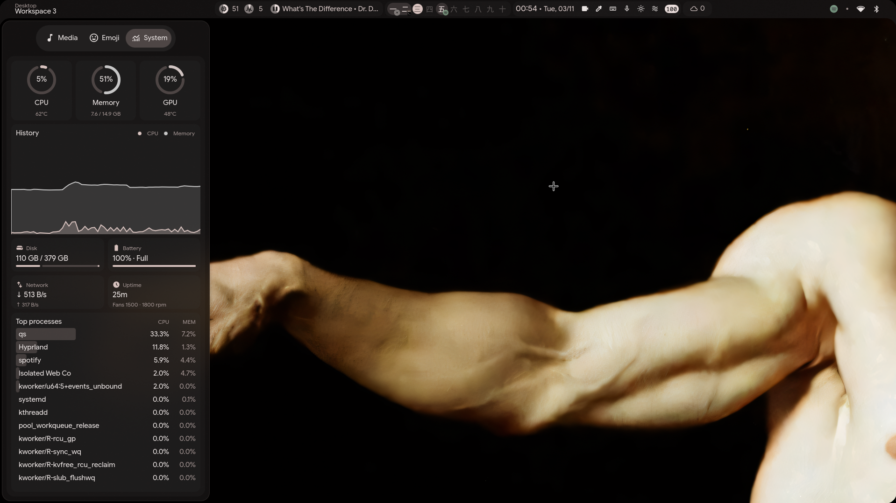
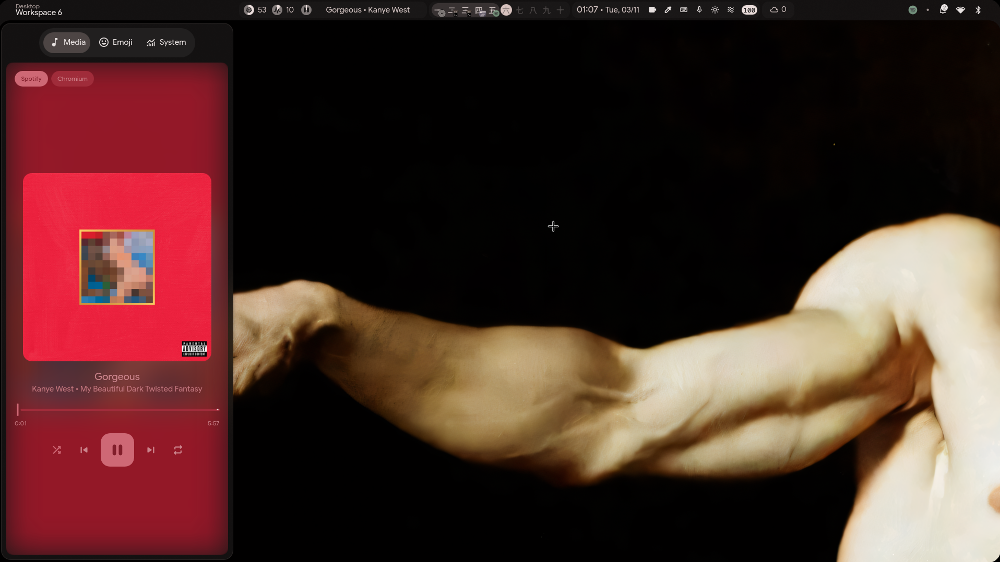
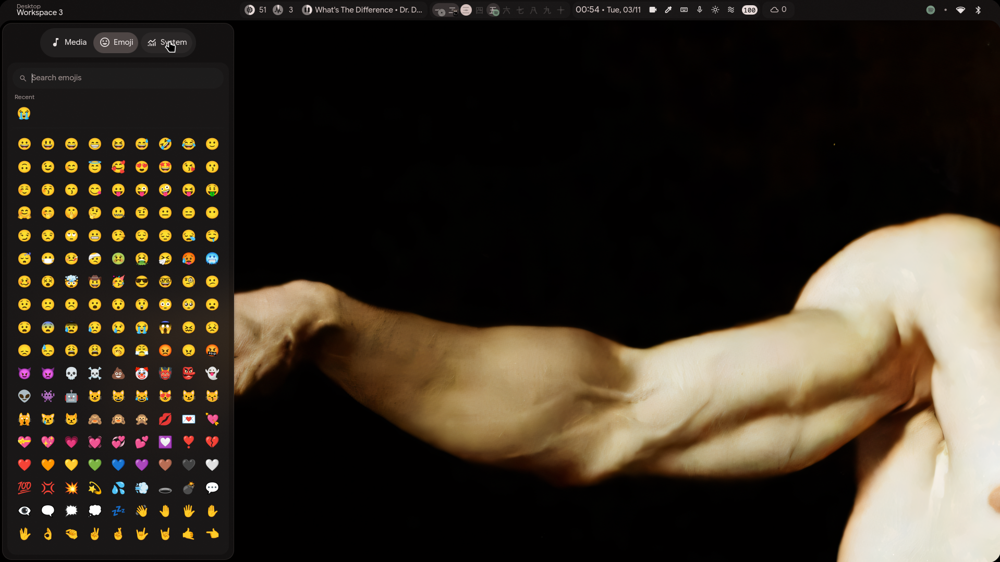
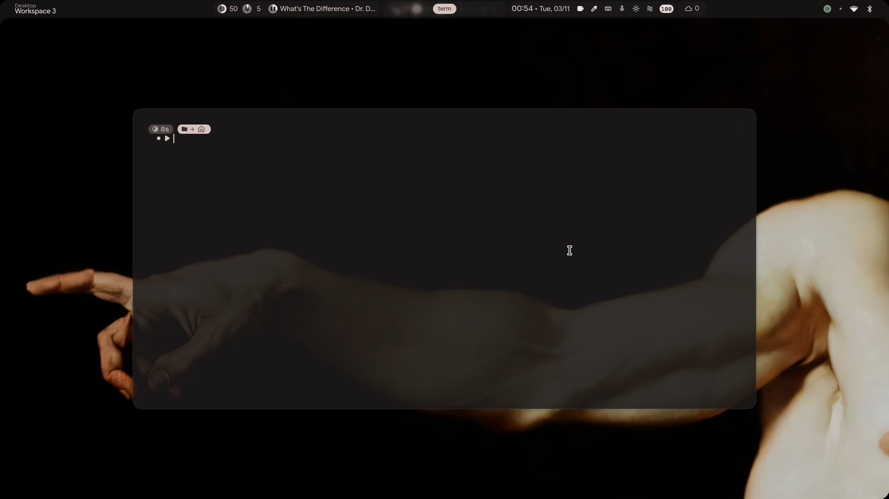
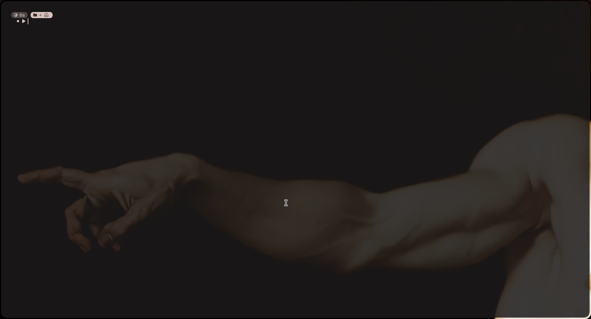
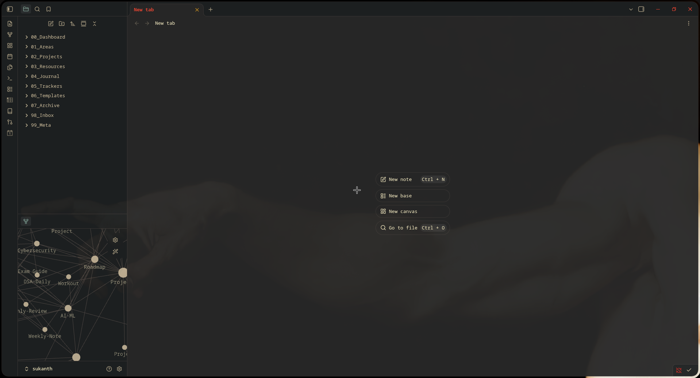
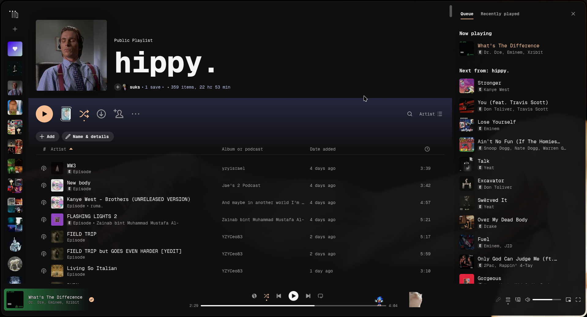

# hyprland-dots

My Hyprland + Quickshell setup. It's a **fork of [end-4/dots-hyprland](https://github.com/end-4/dots-hyprland)** ("illogical-impulse") with my own additions on top: new sidebar tabs, keybinds, a drop-down terminal and other tweaks.

## Screenshots



| | |
|---|---|
|  |  |
| Left sidebar, Media tab (`Super + A`) | Left sidebar, Emoji tab (`Super + .`) |
|  |  |
| Drop-down scratchpad terminal (`` Super + ` ``) | Kitty |
|  |  |
| Obsidian at 0.96 opacity | Spotify at 0.96 opacity |

## Credits

The base of this config (the shell, bar, sidebars, theming and most of the Hyprland setup) is the work of
**[end-4](https://github.com/end-4)** and the contributors to [dots-hyprland](https://github.com/end-4/dots-hyprland).
Go star the original repo.

Everything listed under [What I changed](#what-i-changed) is my own work on top of that.

| Folder | Based on end-4/dots-hyprland at |
|---|---|
| `hypr/` | [`d619ddcd`](https://github.com/end-4/dots-hyprland/tree/d619ddcd8264b6daecf98b50e2ddd19f61ad1ecd/dots/.config/hypr) |
| `quickshell/` | [`aed4d1ec`](https://github.com/end-4/dots-hyprland/tree/aed4d1ec/dots/.config/quickshell) |

`quickshell/ii/modules/common/widgets/shapes` is vendored from end-4's
[rounded-polygon-qmljs](https://github.com/end-4/rounded-polygon-qmljs).

License: GPL-3.0, same as upstream (see [LICENSE](LICENSE)).

## What I changed

Each folder starts with a commit containing end-4's original files, unmodified. My changes come in the
commit after it, so the diffs show exactly what I wrote:

- **Hyprland:** [see diff](https://github.com/Sukanth19/hyprland-dots/compare/109730a0ed32ac89a4db26a82facc123fdbc2bbf...3cfbc3d466fd5fd3447ccbf555d4a4cdcd11e260) (`git diff 109730a 3cfbc3d`)
- **Quickshell:** [see diff](https://github.com/Sukanth19/hyprland-dots/compare/ae2b23e7a15519c1474b54f18432d97ede45f492...2b12ab73cbb15bb6acf9e40a8826240f2e7a0c4a) (`git diff ae2b23e 2b12ab7`)

### Quickshell
- **Left sidebar: 3 new tabs**, written from scratch:
  - **Media**: player switcher, album art, seek bar and playback controls
  - **Emoji**: searchable emoji picker with recents
  - **System**: CPU / memory / GPU usage and temps, history graph, disk, battery, network, uptime, fans and top processes
- New `sidebarLeftMedia` / `sidebarLeftEmoji` global shortcuts that open the sidebar straight on a given tab, or close it if that tab is already showing
- Bar: the screen-record button turns red with a stop icon while `wf-recorder` is running

Files: `sidebarLeft/Media.qml`, `sidebarLeft/EmojiPicker.qml` and `sidebarLeft/SystemMonitor.qml` (new), plus
edits to `SidebarLeft.qml`, `SidebarLeftContent.qml` and `bar/UtilButtons.qml`.

### Hyprland keybinds
| Key | Action |
|---|---|
| `Super + A` | Left sidebar, opens on the Media tab (swapped with `Super + N`) |
| `Super + N` | Right sidebar |
| `Super + .` | Emoji tab in the left sidebar (instead of the launcher's emoji search) |
| `` Super + ` `` | Drop-down scratchpad terminal (kitty, on a special workspace) |
| `Super + Shift + E` | Screenshot a region and annotate it in swappy |
| `Super + Scroll` | Workspace scroll direction inverted |

### Window rules
- Spotify always opens on workspace 5, slightly transparent (0.96)
- Obsidian always opens on workspace 4, slightly transparent (0.96)
- Scratchpad terminal: floating, centered, 70% × 60% of the monitor

### Other
- Cursor: Bibata-Crosshair, size 24
- `udiskie` automounts USB drives on startup
- Colors (`hyprland/colors.lua`, `hyprlock/colors.conf`) are matugen-generated from my wallpaper
- Custom hyprlock background image

### Scripts
- `hypr/custom/scripts/scratchterm.sh`: starts or toggles the scratchpad terminal
- `hypr/custom/scripts/snip_annotate.sh`: `slurp` + `grim` + `swappy`

## Usage

Install end-4's dots first by following [their instructions](https://github.com/end-4/dots-hyprland).
Then copy my files over (back up your own first):

```bash
cp -r hypr/custom ~/.config/hypr/
cp -r quickshell/ii/modules/ii/sidebarLeft ~/.config/quickshell/ii/modules/ii/
cp quickshell/ii/modules/ii/bar/UtilButtons.qml ~/.config/quickshell/ii/modules/ii/bar/
```

The `Super + A` / `Super + .` keybinds need the quickshell sidebar files, so copy both.

Extra packages my changes use: `kitty`, `jq`, `swappy`, `grim`, `slurp`, `udiskie`, `bibata-cursor-theme`,
`lm_sensors` (System tab temps), `wf-recorder` (record button).
